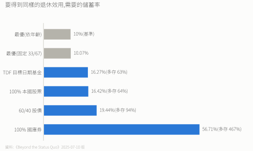
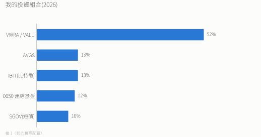
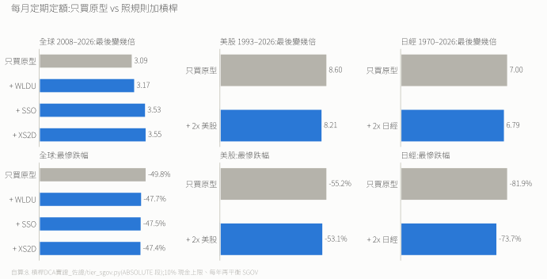

# 0. 投資心法

> 寫給未來、慌張時的自己。細節在其他檔,這裡只放憑直覺就該想起來的東西。
> 一句話:**買下全世界,然後活得夠久。**

---

## 學術地基

論文《Beyond the Status Quo》(Anarkulova、Cederburg、O'Doherty,2025-07-10 版,SSRN 4590406),用 39 個已開發國家 1890–2023 的資料,得出三個結論:

1. **全程 100% 股票、0% 債券**:分散風險靠國際股票,不靠債券。
2. **不隨年齡降股票**:退休後也一樣,因為要對抗長壽風險。
3. **約 1/3 本國 + 2/3 國際**:別重押自己的國家。

> 論文模型是美國夫妻,**台灣不在樣本內**。「台灣人本國留 1/3」是我的推論。

買 TDF 要多存 63%,買 60/40 要多存 94%,才追得上全股最優策略。

---

## 先想清楚三件事

1. **哪筆錢永遠不拿出來?** 從進場那天起永遠在市場裡,只換標的,不出場。
2. **跌多少還睡得著?** 睡得著的配置 > 理論最優的配置。
3. **緊急金放哪?** 台幣定存。任務只有「需要那天金額確定」,不兼差。

之後只剩兩個動作:**買進持有、一年再平衡一次。**

---

## 五條心法

**一、買下全世界。** 不賭單一國家、產業或個股。最純粹是 VT;為了稅,我用 VWRA / VALU + AVGS 達到同樣曝險(VWRA 是既有持股,新錢買 VALU,見 [檔 3](./3.%20VT%20vs%20IMID%20vs%20VWRA%20vs%20VALU%20完整比較.md))。

**二、全股,0 債券。** 論文顯示長期全股報酬更高、破產機率反而更低。降風險靠國際分散,不靠債券。
> 「股票放越久越穩」是論文的主張,學界有爭議(如 Pástor & Stambaugh 2012)。全股結論不靠這點也站得住。

**三、不擇時,持續買。** 就算每次都買在最低點,也只有約 30% 的時候贏過定期定額;晚兩個月抄底,勝率剩 3%(Maggiulli,2019)。任何想動的念頭都要**事前寫死、機械觸發**。

**四、要總報酬,不要高股息。** 股息在台灣要繳綜所稅(5–40%)和二代健保(單筆達 2 萬扣 2.11%)。要用錢就賣股票。
> 賣台股(如 0050)目前免證所稅;賣海外 ETF 的獲利是海外所得,全年達 100 萬要計入最低稅負(扣除額 750 萬)。

**五、稅要當回事。** 選愛爾蘭註冊的 UCITS,不直接買美國 ETF:股息稅 15% 對 30%,而且沒有美國遺產稅(美國資產超過 6 萬美元要課)。

---

## 配置

緊急金另外放:1.5 年生活費,台幣定存。投資組合:

| 標的 | 它的工作 |
|---|---|
| VWRA / VALU | 主引擎,全球股票(兩檔算同一桶) |
| AVGS | 補小型價值股 |
| IBIT | 比特幣,通膨對沖 + 另類資產 |
| 0050 連結基金 | 對沖台幣生活費 + 台積電 |
| SGOV | 抄底用的現金 + 心理緩衝 |

約九成是風險資產。

---

## 四個「我自己加的」

論文沒背書,是個人判斷,要承認是賭注:

1. **比特幣 13%**:刻意超過 [檔 6](./6.%20比特幣ETF投資指南.md) 積極型上限 10%。紀律:每年再平衡回 13%,偏離超過 ±5 個百分點就提前調;跌 70% 不賣。**做不到就降到 10%。** IBIT 是美國資產,遺產稅規則見 [檔 1](./1.%202026投資執行紀錄.md)。
2. **台股 12%(論文建議 33%)**:看空台灣長期(少子化、勞健保),而且日常收入與開銷本來就是台幣。是主動偏離。
3. **SGOV 10%(論文建議 0%)**:本質是有紀律的擇時,付現金拖累換心理穩定。回測裡每年把 SGOV 補回 10%,全球和美股每年約少 0.8 個百分點(見 [檔 8](./8.%20槓桿DCA實證.md))。
4. **大跌時分批買槓桿 ETF(選配)**:論文說用一般借貸成本,最佳槓桿是 0%,這是個人偏離。回測結果:

   

   **跟只買原型比,每年差 −0.2 到 +1.3 個百分點,跌幅小一點是 SGOV 墊的,不是槓桿。** 要不要玩自己決定,細節見 [檔 8](./8.%20槓桿DCA實證.md)。要玩就守:
   - 只能分批買,絕不一次梭哈(日經跌一半時全買 2 倍,34 年後只剩 1.04 倍,原型 3.58 倍)。
   - 觸發點事前定死:VWRA 距高點 -20% / -30% / -50% 各用一批 SGOV;跌破 -30% 時,每月原本買原型的 90% 改買槓桿,漲回前高 80% 改回。
   - **上限:累積丟進槓桿的錢 ≤ 總投入 10%**,用投入的錢算,不用市值算。滿了之後 SGOV 留著,新錢回去買原型。
   - 不賣原型換槓桿,也不賣槓桿換原型。
   - **再平衡**:槓桿部位不參與、不算進比例;SGOV 用掉後只靠新錢補,不在低點賣股票補。
   - 只用 2 倍;標的被清算就把錢買回原型。
   - 候選(只考慮倫敦與美股):WLDU(全球 2 倍,美國註冊、很小)、XS2D(美股 2 倍,盧森堡)、SSO(美股 2 倍,美國註冊)。

---

## 人性防線

| 想… | 其實是 | 該做 |
|---|---|---|
| 先跑再說 | 損失厭惡 | 不賣,繼續買 |
| 這次我看得準 | 過度自信(2025 看空台股被打臉) | 重讀論文 |
| 等跌到底 | 擇時 | 持續買 |
| 別人都在賣 | 羊群效應 | 照規則 |
| 成本是 XX 不能賠賣 | 錨定 | 只看未來 |
| 只看支持我的消息 | 確認偏誤 | 定期讀反方 |

**想更激進時**:先睡一覺。撐得過一晚的是思考,隔天就淡的是 FOMO。

想像有一天要跟家人解釋這筆錢,只會有兩種答案:
- 「我設計了一套方法,精確執行了二十年。」結果好壞都站得住。
- 「我中途嫌不夠快,自己改了規則,然後失敗了。」沒有辯護空間。

**報酬是市場給的,紀律是我給的。我只為後者負責。**

---

## 一頁速查

- 永遠不拿出來的錢先定好;緊急金台幣定存。
- 買下全世界,0 債券。
- 不擇時、不停扣、跌不賣、一年再平衡。
- 要用錢就賣股,不追高股息。
- 選愛爾蘭 UCITS。
- 想動手前問:**這個動作事前寫死了嗎?** 沒有就不動。

---

## 附錄

**A. 為什麼 0 債券**:長債波動大,不適合一般人;中債的角色用「全股 + SGOV」取代;SGOV 0–3 個月,等同現金。

**B. 為什麼配 AVGS**:市值型 ETF 吃市場因子,小型價值再吃規模與價值因子。AVGS 是愛爾蘭 UCITS,跟 VWRA 稅務一致。

**C. 槓桿為什麼一定要設上限**:每日重置會耗損,年化約 ½ × L × (L−1) × σ²。波動 20% 時 2 倍耗 4%/年,波動 50% 時耗 25%/年,而深跌時波動最大。大仁哥結論:原型年化低於 8% 時,正二長期輸原型(letf.com.tw/13295-2)。

---

> 看完還想改配置 → 先睡一覺。佐證:[檔 10 論文筆記](./10.%20論文筆記：Beyond%20the%20Status%20Quo.md)、[檔 1 執行紀錄](./1.%202026投資執行紀錄.md)、[檔 8 槓桿回測](./8.%20槓桿DCA實證.md)。
