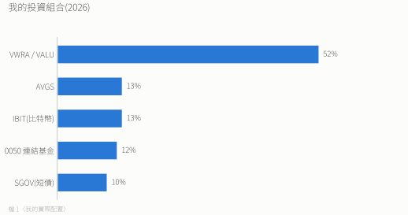
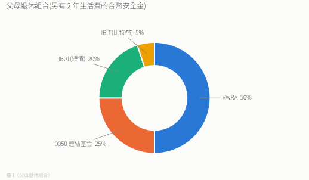
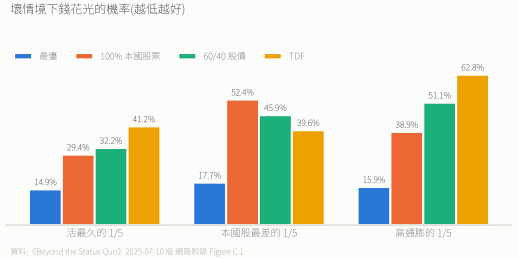

# 2026 投資執行紀錄

> 個人執行細節。原則見 [`0. 投資心法總綱.md`](./0.%20投資心法總綱.md),這裡不重述。

## 背景

- 台灣,累積期。
- 緊急金:1.5 年生活費,台幣定存。

---

## 我的配置(2026)

| 標的 | 預期年化 | 管道 / 備註 |
|---|---|---|
| VWRA / VALU | 8% | 同一桶。既有 VWRA 不動,**新的定期定額買 VALU**(富邦代號 VAVALU,費用 0.07%) |
| AVGS | 未估 | 補小型價值;愛爾蘭 UCITS |
| IBIT | 15% | 美國資產,注意遺產稅 |
| 0050 連結基金 | 8% | 基富通 0 手續費定期定額;累積型 |
| SGOV | 2.5% | 抄底彈藥;利息對非美國人免 30% 預扣 |

- 再平衡時 VWRA + VALU 合計 52%,兩檔之間不互相調整;不賣 VWRA 換 VALU(避免實現海外所得與來回手續費)。
- 槓桿部位不參與再平衡、不算進任何比例。SGOV 在股災中用掉後,只靠每月新錢補回,不賣股票補。

**券商**

| 平台 | 買什麼 | 手續費 |
|---|---|---|
| Firstrade | 美國註冊標的(SGOV、IBIT 等) | 0 |
| 富邦複委託 | 倫敦掛牌的愛爾蘭 UCITS(VWRA、VALU、AVGS、IB01) | 買賣各 0.15% |

**槓桿衛星(選配)**:規則與回測見 [檔 0](./0.%20投資心法總綱.md) 第 4 點和 [檔 8](./8.%20槓桿DCA實證.md)。選美國註冊的標的(WLDU、SSO)要計入下面的遺產稅規則。

---

## 觀點演進

| | 2025 | 2026 |
|---|---|---|
| 股市 | 預期熊市 | 承認無法預測 |
| 通膨 | 高通膨持續 | 90% 風險資產 + 比特幣對沖 |
| 債券 | 降債 | 只留 10% SGOV |
| 比特幣 | 10% | 13% |
| 台股 | 看空但看好台積電 | 降到 12%,只當匯率對沖 |

提醒自己:2025 看空台股被打臉。

---

## 緊急金為什麼不放美元

- 日常開銷用台幣,緊急金就該是台幣。放美元可能在最需要錢那天被迫換匯、吃匯損。利差對這筆錢不重要。
- 台灣銀行的美元帳戶擋不了台海級事件,真要避險得放境外,屆時另計。

---

## 遺產稅規劃

| 標的 | 課哪國遺產稅 |
|---|---|
| VWRA / VALU / AVGS / IB01 | 不課美國(愛爾蘭註冊) |
| 0050 連結基金 | 台灣 |
| IBIT / SGOV / 美國註冊槓桿 ETF / Sin A Little 的美股 | **美國**:非居民超過 6 萬美元的部分課 18–40%,台美無協定 |

**美國資產觸發規則**:每年再平衡時合計一次。
- **超過 6 萬美元**:
  1. SGOV 的新錢改買 IB01,既有 SGOV 逐步轉過去。
  2. IBIT 另找替代方案(目前沒有查證過的愛爾蘭比特幣基金)。
  3. 留說明給家人:身故後要向 IRS 申請移轉證明,約 12–18 個月才能動用。
- **低於 6 萬美元**:維持現狀。

**台灣遺產稅**:免稅額 1,333 萬。超過時可用:
- 配偶間贈與:整筆不計入贈與總額(遺贈稅法 §20)。
- 贈與子女等其他人:每人每年 244 萬免稅。
- 子女教育信託、保險、海外配置。
- 注意:死亡前 2 年內贈與配偶或繼承人,仍併入遺產(§15);2026-09-11 修正的 §6 第 3 項規定,這部分遺產稅由受贈人按比例負擔。

---

## 父母退休組合

> 給「沒有月退、生活費全靠變現資產」的退休者的配置,不是論文建議。提領規則見 [檔 11](./11.%20提領規則.md)。

**設計前提**(跟累積期的人不一樣):
- **沒有月退**:論文模型的退休者有社會安全給付墊底,這裡假設沒有。
- **沒有其他收入**:生活費 100% 靠變現資產。
- **承受不了永久損失**:只持有分散的市值型工具,不碰個股。

**第一層:安全金(組合外)**:2 年生活費,台幣定存。用固定年數,不用比例:組合下跌時,用比例算的安全網會最薄。

**第二層:投資組合**

| 標的 | 為什麼 |
|---|---|
| VWRA 50% | 主引擎 |
| 0050 連結基金 25% | 唯一的台幣成長資產 |
| IB01 20% | 取代他們沒有的月退 |
| IBIT 5% | 有條件持有(見下) |

股票部位 本國:國際 = 25:50 = 1:2,與論文一致。

**為什麼用 IB01 不用 SGOV**:這 20% 是長期停泊,不會在股災時花掉。IB01 免美國遺產稅,身故時家人不必等 IRS 移轉證明。

**為什麼短債 20%(我只有 10%)**:這是最大的主動偏離。論文最優是 0% 國庫券(依年齡版只在 65 歲短暫持有 27%,70 歲歸 0)。給 20% 是要替代缺席的月退,不是擇時,也不是「年紀大要保守」。

**為什麼台股 25%,不再加**:0050 集中在台積電,加上我看空台灣長期;對承受不了永久損失的人,集中風險比匯率風險難消化。上限 33%。

**為什麼不買 AVGS**:長期多賺零點幾個百分點、方向不確定,卻多一檔要管。更關鍵的是,小型價值可以落後十年(2010–2020),**提領期的人等不起**:落後期等於被迫低賣。

**IBIT 5% 的條件**:先問父母能不能接受跌 70% 不賣;不能就改放 VWRA。5% 跌 70% 只影響總資產 3.5%,對沖效果同樣有限,是象徵性部位。

**兩層緩衝能撐多久**(只靠比例就能算):
- IB01 20% ÷ 4% 年提領 ≈ 5 年
- 安全金 2 年
- **合計約 7 年不必賣股票**。美股含息回到前高:2000 年高點花 6.6 年、2007 年 4.9 年、2020 年半年(自算),都在 7 年內;但日經 1989 年的高點花了 34 年,7 年擋不住那種。提領率 5% 時,IB01 只撐 4 年。
- 美國百年回測裡,20% 現金「股災先花現金」的緩衝**沒有降低錢花光的機率**,反而更高(見 [檔 11](./11.%20提領規則.md));它買到的是「不必在低點賣股票」的安心,不是更高的成功率。

**擋不住的:長壽風險。** 活得比預期久,短債會被提領耗盡。要靠提領規則處理(見 [檔 11](./11.%20提領規則.md))。

**講給父母聽的紀律**:不碰個股、不追高股息(除息就是拿回自己的本金)、跌不賣、不隨年齡再降股票。

---

## 論文關鍵數字

- 最優策略一般情況下的破產機率 6.7%(固定權重 7.0%),TDF 19.7%。
- 達到同樣效用,TDF 需要 16.27% 儲蓄率(多存 63%)。
- 數字依 2025-07-10 版論文(`paper/`)。2024-11-18 舊版對應為 61%、7.0%、14.9%、15.3%。
