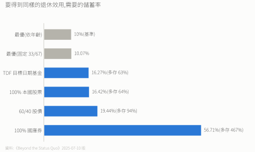
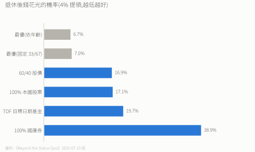
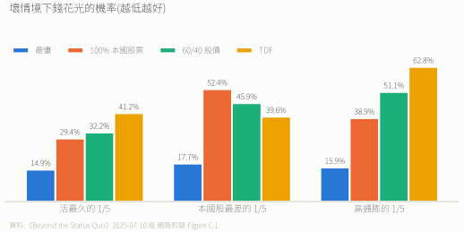
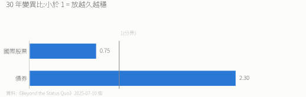
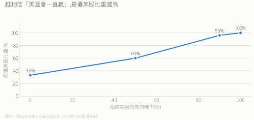

# 論文筆記:Beyond the Status Quo

> **A Critical Assessment of Lifecycle Investment Advice**
> Anarkulova(Emory)、Cederburg(Arizona)、O'Doherty(Missouri)
> 版本:2025-07-10(即 [`paper/`](./paper/) 內附 PDF,本筆記數字依此版核校),SSRN 4590406
>
> 版本差異:2024-11-18 版以「最優固定權重」為基準(TDF 多存 61%);2025-03 版新增美國例外論;2025-07-10 版改以「最優依年齡策略」為基準(TDF 多存 63%)。

---

## 一句話

**全程 100% 股票、約 1/3 本國 + 2/3 國際、0% 債券,不隨年齡調整。** 用國際股票分散,不用債券。

| 傳統建議 | 論文結論 |
|---|---|
| 股債混合 | 100% 股票 |
| 年紀越大股票越少 | 所有年齡幾乎相同 |
| 主要買本國 | 1/3 本國 + 2/3 國際 |

---

## 研究方法

- **資料**:39 個已開發國家、1890–2023、2,600 多個「國家-年」。**台灣不在樣本內。** 只有丹麥、法國、德國、英國、美國涵蓋全期;其他國家只納入被歸為已開發的期間(也含阿根廷、智利、韓國等國的部分年份)。
- **方法**:從歷史報酬中抽連續區塊(平均 120 個月)重組未來情境,不假設常態分布,保留波動聚集與資產間的相關性。
- **模型**:美國夫妻,25 歲工作、65 歲退休,存收入的 10%;風險趨避係數 3.84;考慮薪資風險、社會安全給付、壽命與遺產。
- **對照組**:100% 國庫券、100% 本國股、60/40 股債、TDF(目標日期基金,退休後多數時間只有 17% 股票)。

---

## 主要發現

### 最優配置

- **固定權重**:33% 本國股 + 67% 國際股,0% 債券,所有年齡不變。
- **依年齡最優**:幾乎相同,只在退休初期持有國庫券(65 歲 27%、68 歲 7%、70 歲歸 0)。這是 4% 固定提領下的戰術現金;改成彈性提領就全程全股,效用差異很小。

### 要存多少錢

- 改配 20% / 30% / 40% 債券,分別要多存 20% / 35% / 54%。
- 最優策略的退休財富比 60/40 多 50%、比 TDF 多 39%;遺產中位數最優 96 萬美元 vs TDF 27 萬美元。

### 錢花光的機率(4% 提領,最後一位配偶身故前歸零)

即使在最壞的情境,最優策略都比 TDF 好。

---

## 為什麼傳統建議錯了

1. **太依賴美國歷史**:美國 20 世紀可能是倖存者偏誤;他國經歷過戰爭、惡性通膨、崩盤。
2. **股票放越久越穩,債券相反**:

   

   這是論文的實證;學界對股票長期是否更穩仍有爭議(如 Pástor & Stambaugh 2012)。
3. **債券避不了險**:債券與通膨相關 −0.78(國際股 −0.01);跟本國股的相關性從短期 0.21 升到 30 年 0.45,危機時一起跌。
4. **國際分散有效**:國際股與本國股相關約 0.33,而且長期穩定。

---

## 敏感度

- **風險偏好**:風險趨避係數從 0.5 到 10,最優都是本國 32–35% + 國際 65–68%、0% 債券。遺產動機、提領率 3%/5%、退休年齡、儲蓄率、單身或雙薪,結論都一樣。
- **薪資與本國股市相關**:相關 0.1 → 本國 30%;相關 0.5 → 本國 18%。債券都是 0%。
- **偏離的代價**:本國 / 國際在 11/89 到 55/45 之間,效用都差不多;加債券的代價大得多。

### 借錢加槓桿(Table VII Panel M)

| 借貸利差(高於國庫券) | 代表 | 最佳借款比例 |
|---|---|---|
| 6.50% | 一般家戶借貸成本,約等於券商融資利率中位數 | **0%** |
| 1.40% | 最便宜的券商融資 | 55% |
| 0.37% | 接近無風險利率 | 100%(模型上限,另配 15% 債) |

用一般融資利率借錢,最佳槓桿是 0。模型還假設維持槓桿比例沒有交易成本與追繳,現實更差。

### 美國例外論(§5.4.5)

超配美股需要對「美國會一直贏」有很強的信念。50% 信念時的 60% 美股,接近目前全球市值權重。

---

## 實務

- 放棄「年紀大就買債券」;2/3 放國際;長期持有。
- 嚴格照論文是本國:國際 = 1:2(例如美國人 VTI:VXUS)。VT / VWRA 是市值加權(美國約 6 成),**不等於**論文的 33/67。

**限制**:歷史不代表未來;沒算稅;假設完美追蹤指數;社會安全給付制度可能改變;國際投資有匯率風險。

---

## 原文摘錄

> "Target-date fund investors need 63% more pre-retirement savings to match the optimal strategy's expected retirement utility."
>
> "Our investors prefer diversifying with international stocks, not bonds."
>
> "Bonds' per-year variance increases to 2.30 times the one-year variance, but international stocks' decreases to 0.75 times."

(引自 2025-07-10 版摘要與 §1。)
