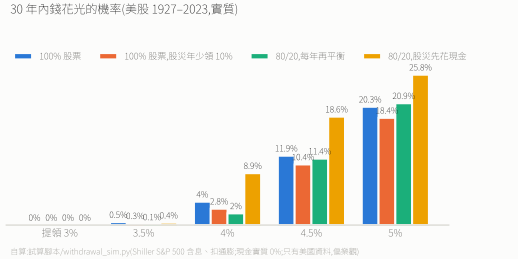
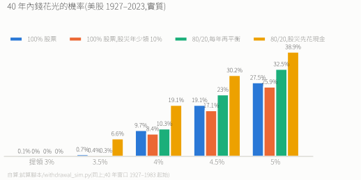

# 提領規則

> 退休後怎麼把錢拿出來。前面幾篇都在講累積期,這篇補上提領期。
> 寫給一般投資人;文中的「沒有月退的人」指生活費全靠變現資產的退休者。父母組合的實際設定見 [檔 1](./1.%202026投資執行紀錄.md)。

---

## 一句話結論

**每年領「固定實質金額」,股災年少領 10%,再加上「跑輸就永久減 10%、跑贏就加 10%」的護欄;起始提領率 3.5%,沒有月退的人 3% 以下;退休後仍以股票為主,每年再平衡一次,當年要領的錢從超配的那邊拿。** 現金緩衝是買安心的,不要指望它提高成功率:美國百年回測裡,「股災先花現金、不再平衡」的錢花光機率反而最高。**護欄讓錢幾乎不會花光,代價是壞年代收入可能砍到一半**,所以地板收入(年金)越少,起始提領率要越低。

---

## 一、三種提領方式

| 方式 | 怎麼算 | 錢會不會花光 | 每年收入穩不穩 | 美股回測(30 年、4%) |
|---|---|---|---|---|
| **固定實質金額**(4% 法則) | 第一年領組合的 4%,之後每年只隨通膨調整 | 會 | 最穩 | 4.0% 的情境花光 |
| **市值定率** | 每年領「當時市值」的 4% | 不會(永遠只領一部分) | 最不穩:1929 年後,收入最低只剩原本的 21% | 不會花光,但收入可能腰斬再腰斬 |
| **固定金額 + 股災少領**(本篇預設) | 同固定實質金額,但股票距前高跌超過 20% 的那幾年少領 10% | 會,但比固定金額少 | 最差只少 10% | 2.8% 的情境花光 |

- 論文用的就是固定實質金額的 4% 法則(Bengen 1994)。它在 65 歲配 27% 國庫券、70 歲歸 0,**作者明說這是因為 4% 法則太死板,需要現金應付報酬順序風險**;改成「每年領當時市值的 4%」,最優策略全程 0 債券、0 國庫券(論文 p.4、p.20、Figure 4 p.54)。3%、5%、市值定率三種規則下,最優固定權重都是 34/66 全股(Table VII Panel G,p.49)。
- 市值定率在數學上不會花光,但沒有月退的人,收入一年掉 40% 就是生活費掉 40%,撐不住。**固定金額 + 股災少領**是兩者之間的折衷:收入大致穩定,又在最傷的年份減少賣在低點。

---

## 二、提領率要多少

| 錢花光的機率(美股 1927–2023,實質) | 3% | 3.5% | 4% | 4.5% | 5% |
|---|---|---|---|---|---|
| 30 年,100% 股票 | 0% | 0.5% | 4.0% | 11.9% | 20.3% |
| 40 年,100% 股票 | 0.1% | 0.7% | 9.7% | 19.1% | 27.5% |
| 40 年,股災年少領 10% | 0% | 0.4% | 8.4% | 17.1% | 25.9% |

- **4% 是美國資料、30 年的數字。** 美國是過去一百年表現最好的市場之一,用它算出的安全提領率偏樂觀;退休期拉到 40 年,4% 的失敗率就升到約 1/10。
- 論文的最優策略在 4% 法則下仍有 **6.7%** 的機率在過世前花光,而且那是有美國社會安全給付墊底的情況(論文 p.4)。
**其他研究怎麼說:**

| 研究 | 資料 | 結論 |
|---|---|---|
| Bengen(1994) | 美國,50/50 股債 | 60–65 歲退休約 **4%**,之後隨通膨調整;5% 有風險,6% 以上是「賭博」 |
| Trinity study(Cooley、Hubbard、Walz 1998) | 美國 1926–1995 | 4%、30 年:100% 股票成功率 95%,75/25 為 98% |
| Morningstar(2026 年版) | 前瞻估計,股票 30–50% | 30 年、90% 成功:**3.9%**;40 年:3.2%(二手轉述,原文未開啟) |
| Anarkulova、Cederburg、O'Doherty、Sias(2025) | **38 個已開發國家** | 65 歲夫妻願承受 5% 花光機率,每年只能領 **2.31%** |

- 美國資料給出 4%,全球資料只有約 2.3%。差距來自美國是過去百年的贏家;未來不一定。
- **預設 3.5%,而且一定要搭配第七節的護欄**:有了「跑輸就減」,實際提領率會隨市場往下調,不是死守 3.5%。死守固定金額、不打算調整的人,要接近國際研究的 2.3–3%。
- **沒有月退的人用 3% 以下**(見第六節)。

---

## 三、4% 的分母:包不包含組合外的安全金?

**不包含。** 分母只算投資組合(含組合內的短債),組合外的安全金不算。

- 安全金的任務是「股災時不必賣股票」的時間緩衝,不是可以花的額度。算進分母,等於事先把緩衝花掉,真的股災時就沒有東西可以撐。
- 論文的 4% 也是用退休帳戶的餘額算,不含其他現金。
- 代價是每年少領一點(安全金 2 年生活費時,約少 8% 的提領額度),換來緩衝真的在。

---

## 四、提領順序與股災觸發

每年年初做一次,事前寫死、機械執行:

1. **決定今年領多少**:去年的金額 × (1 + 去年通膨)。如果全球股票(例如 VWRA)距歷史高點跌超過 20%,今年少領 10%;回到 −20% 以內的下一年恢復原本金額(不補回少領的部分)。
2. **再平衡,今年的錢從超配的那邊拿**(目標比例例如股票 80%、短債 20%,回測用的就是這組):平常年,股票通常超配,就賣股票;股災年,股票低於目標,錢就從短債(SGOV / IB01)拿,同時把短債多出來的部分買回股票,回到目標比例。
3. **組合外的安全金**:只在「股災年、而且組合內短債已經領到 0」時才動用。
4. 以上都用完,才在低點賣股票。

**為什麼不是「股災先花現金、什麼都不動」**:直覺上,股災時用現金付生活費、不碰股票最安全,但回測顯示相反:

| 4% 提領,錢花光的機率 | 30 年 | 40 年 |
|---|---|---|
| 100% 股票 | 4.0% | 9.7% |
| 80/20,每年再平衡(本篇做法) | 2.0% | 10.3% |
| 80/20,股災先花現金、跌深不再平衡 | **8.9%** | **19.1%** |

- 「先花現金」那組在股災時把現金花掉,沒有拿現金去低點買股票;股市回來時,手上的股票比較少。每年再平衡則是強迫在低點買回股票。
- 現金實質報酬假設 0%;改成每年 1%,結論不變(30 年 7.9% 對 0.5%)。
- 論文的結論相同:保留現金緩衝的價值很小,全股策略只要多存 0.05%(10.05% 對 10.00%)就追平(論文 p.20–21)。
- **所以現金緩衝要多大,是「睡不睡得著」的問題,不是「會不會比較安全」的問題。** 要留就留,但別期待它降低失敗率。

---

## 五、緩衝怎麼重建

- **組合內短債**:每年再平衡自動補回目標比例(平常年賣股票補)。不需要另外的規則。
- **組合外安全金**:動用過之後,在第一個「股票距高點跌不到 20%」的年份,一次從股票賣出補滿。股災年不補,不在低點賣股票補現金。
- 這跟累積期 [檔 8](./8.%20槓桿DCA實證.md) 的 SGOV 規則同一個精神:用掉之後,不在低點賣股票補。

---

## 六、沒有月退的人

論文模型裡的退休者有美國社會安全給付;論文說的「花光」是指積蓄歸零後只剩社會安全給付和補充安全收入(SSI)(論文 p.23)。**沒有月退的人,花光就是收入歸零**,所以要更保守:

1. **先算地板收入**:勞保老年年金、國民年金這類終身給付,有多少算多少。生活費減掉地板,剩下的缺口才由組合支付。缺口越小,能用的提領率越接近 4%。勞保老年年金的算法(勞工保險條例 §58-1,擇優):平均月投保薪資 × 年資 × 0.775% + 3,000 元,或平均月投保薪資 × 年資 × 1.55%。
2. **完全沒有地板的人,用 3% 以下,而且一定要搭配股災少領與護欄。** 美國資料 40 年、3% 幾乎不失敗,但 38 國的研究只有 2.31%。
3. 想把地板補起來,可以考慮終身年金型商品(把一筆錢換成活多久領多久);產品評估不在本專案範圍。
4. 不要因為沒有月退就把股票降很低:論文裡 100% 國庫券的破產機率是 **38.9%**,60/40 是 16.9%,都比最優全股的 6.7% 高(論文 p.4、p.23)。

---

## 七、長壽風險

- 論文的模擬裡,夫妻中較長壽者的死亡年齡:5% 分位 70.8 歲、95% 分位 **100.0 歲**(論文 p.13)。65 歲退休要準備 35 年,60 歲退休要準備 40 年。
- 40 年 × 4% 的失敗率約 1/10;3.5% 以下才接近 0。退休越早,提領率越要低。
- 不要隨年齡把股票降到很低。論文的最優策略退休後仍幾乎全股,原因正是長壽風險:活越久,越需要股票的成長(論文 p.4)。
- **護欄**(Guyton & Klinger 2006):每年檢查一次「今年要領的錢 ÷ 組合市值」。
  - 比起始提領率高出 20% 以上(例如起始 3.5%,現在超過 4.2%):組合跑輸了,**之後的金額永久減 10%**。
  - 比起始提領率低 20% 以上(現在低於 2.8%):組合跑贏了,之後的金額加 10%。
  - 股災少領(第四節第 1 點)是暫時的,護欄是永久的。Guyton & Klinger 原文用這組規則,65% 以上股票的組合在 40 年、99% 信心下,起始提領率可以到 5.2–5.6%(美國資料);本篇不靠它提高起始提領率,只拿它當安全閥。

**護欄不是免費的**:錢不會花光,是因為收入被砍了。美國資料、3.5%、40 年:

| 做法 | 錢花光的機率 | 收入最低降到原本的(最差 / 10% 的人 / 一半的人) |
|---|---|---|
| 固定實質金額,100% 股票 | 0.7% | 100%(但有人花光) |
| 股災年少領 10% | 0.4% | 90% |
| 護欄,100% 股票 | 0% | 39% / 53% / 86% |
| **本篇做法**:80/20 每年再平衡 + 股災少領 + 護欄 | 0% | 48% / 59% / 86% |
| 市值定率 | 0% | 21% / 43% / 70% |

- 「10% 的人」= 每 10 個退休者裡最倒楣的那 1 個,收入在某段時間降到計畫的 53–59%。通常是剛退休就遇上大跌、或遇上長期高通膨的人(推論,未逐一核對起始年份)。
- 所以要先想清楚:**收入降到一半時,生活費撐不撐得住?** 撐不住的那部分,要靠地板收入(年金),或一開始就用更低的提領率。

---

## 回測怎麼做的、還不知道什麼

- 資料:Shiller 美股月資料(S&P 500 含息,用 CPI 扣通膨),1927-01 到 2023-06;每個月都當一個新退休者的起點,30 年有 799 個起點、40 年有 679 個。腳本:[`試算腳本/withdrawal_sim.py`](./試算腳本/withdrawal_sim.py)。
- **只有美國**:美國是過去百年最好的市場之一,其他國家的安全提領率普遍更低。
- 沒有計入稅、手續費、匯率;現金實質報酬假設 0%(1% 的敏感度見第四節)。
- 「股災」用名目含息指數距歷史高點 −20% 判斷,和檔 0、檔 8 的觸發點一致;回測逐月判斷,文中規則是每年判斷一次。
- 「每年再平衡」那組在回測裡是每月按比例提領、每年再平衡一次,近似文中「從超配的那邊拿」;「股災先花現金」那組是股災時只從現金領、股災中不再平衡,平常年才補回現金。
- 論文頁碼指 [`paper/`](./paper/) 內附 PDF(2025-07-10 版)的實體頁序。

> 每個數字的出處見 [`資料來源紀錄.md`](./資料來源紀錄.md)。
