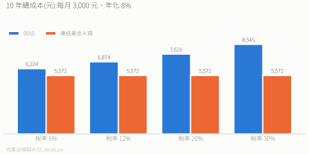

# 0050 vs 元大台灣卓越50連結基金 A 類

> **結論:小額定期定額,連結基金在每個稅率級距都不比 0050 貴。** 稅率 12% 以上差距明顯(不配息,省股利稅);5% 稅率幾乎打平(10 年差幾百元)。
>
> 2026-11 重算(0050 改半年配、殖利率約 1.24%、內扣用官方總費用率)。舊版「5% 稅率選 0050」已不成立。

---

## 基本資料

| | 0050 | 連結基金 A 類 |
|---|---|---|
| 類型 | ETF,股市買賣 | 基金,平台申購 |
| 成立 | 2003 | 2019 |
| 投資標的 | 台灣 50 指數 | 90% 以上投資 0050 |
| 規模(2026-10-30) | 約 24,556 億 | 約 866 億 |
| 最低金額 | 1 股(約 105 元) | 元大官網 1,000 元;基富通 3,000 元 |
| 配息 | 半年配(1、7 月) | 不配息 |

---

## 費用

台灣基金的官方總費用率 = 經理費 + 保管費 + 其他費用(指數授權、交易成本等)。只看經理費 + 保管費(約 0.1%)會低估。

| | 0050 | 連結基金 |
|---|---|---|
| 總費用率 | **0.22%**(SITCA 2025 年度) | 約 **0.23%**(自身一層約 0.02% + 間接負擔 0050 的 0.209%,估) |

- 0050 的 0.22% 含基金內部交易成本(經理費 0.11%、保管費 0.03%、其他 0.05%、手續費 0.01%、交易稅 0.02%)。2025-01-24 起降費,2024 年度是 0.42%。
- 連結基金若保留幾 % 現金,多頭時會有現金拖累,可能比費差更大,實際持有比例看月報。

---

## 10 年成本拆解(每月 3,000 元,總投入 36 萬)

**假設**:年化 8%;0050 殖利率 1.24%、半年配、33% 股利需課稅;0050 買賣手續費 6 折、賣出證交稅 0.1%;連結基金基富通 0 手續費。

| | 0050 | 連結基金 |
|---|---|---|
| 內扣 | 5,239 | 5,572(多 333) |
| 買賣成本 | 1,310 | 0 |
| 股利稅(稅率 5% / 12% / 20% / 30%) | −325(退稅)/ 325 / 1,068 / 1,996 | 0 |

- 連結基金多付的內扣(333 元)小於 0050 的買賣成本(1,310 元),所以每個級距都不吃虧。
- 5% 稅率的差距約 650 元,只佔 54 萬終值的 0.1%,實務上打平。
- 殖利率回到 2.5% 時,5% 稅率仍是連結基金省約 320 元。

---

## 金額變大後的兩道門檻

- **二代健保**:單筆配息達 2 萬元扣 2.11%。0050 一次配約 0.62%,持有約 **323 萬**以上就會被扣;連結基金不配息,沒有這筆。
- **股利抵減上限**:每戶 8 萬元(約對應年股利 94 萬),超過後 5% 稅率的退稅不再增加。

---

## 怎麼選

| 選 | 適合 |
|---|---|
| 0050 | 想領配息、要盤中即時買賣、不想開基金平台 |
| **連結基金** | **定期定額的預設**,稅率 12% 以上更明顯 |

> 借券節稅不在本文範圍:效果取決於借券人何時賣,出借人無法控制。想穩定避股利稅,用不配息的連結基金即可。
