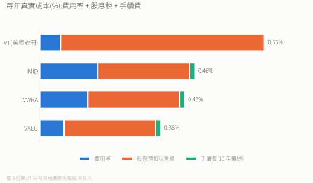
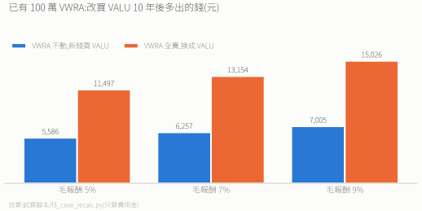

# VT vs IMID vs VWRA vs VALU:全球股票 ETF 比較

> **結論:台灣人不要買 VT,三檔愛爾蘭 UCITS(IMID / VWRA / VALU)任選都對。**
> VT 帳面費用最低,但股息稅與美國遺產稅讓它真實成本最高。
> 三檔愛爾蘭的稅務相同:要**最便宜又含小型股**選 VALU(2026-08 才成立);要**規模最大、紀錄最長**選 VWRA;要 MSCI 指數選 IMID。

---

## 基本資料

| | VT | IMID | VWRA | VALU |
|---|---|---|---|---|
| 發行商 | Vanguard | State Street(SPDR) | Vanguard | Vanguard |
| 註冊 / 掛牌 | 🇺🇸 美國 / NYSE Arca | 🇮🇪 愛爾蘭 / 倫敦 | 🇮🇪 愛爾蘭 / 倫敦 | 🇮🇪 愛爾蘭 / 倫敦(英鎊代號 VALL) |
| 成立 | 2008 | 2011-05-13 | 2019 | **2026-08-18** |
| 費用率 | **0.06%** | 0.17% | 0.14%(2026-07-28 起,原 0.19%) | **0.07%** |
| 指數 | FTSE Global All Cap | MSCI ACWI IMI | FTSE All-World | FTSE Global All Cap(同 VT) |
| 含小型股 | ✅ | ✅ | ❌ | ✅ |
| 持股數 | 約 10,000 | 約 5,973 | 約 3,800 | 約 6,977(抽樣) |
| 全球市值涵蓋 | 約 98–99% | 約 99% | 約 90% | 約 98% |
| 美國權重 | 約 62%(2026-09-30) | 約 64%(2026-10-29) | 約 62%(2026-09-30) | 約 62%(2026-09-30) |
| 規模 | ETF 股別約 $818 億(全基金約 $1,012 億) | 約 $96 億(2026-10-30) | 此股別約 €566 億(全基金約 $873 億) | 約 $42 億 |
| 倫敦日均成交 | 不適用(在美股交易) | 約 28 萬股(約 US$360 萬,2026-10) | 約 24 萬股(約 US$4,500 萬,2026-10) | 約 190 萬股(約 US$950 萬,2026-10) |
| 配息 | 季配 | 累積 | 累積 | 累積 |
| 美國遺產稅 | ⚠️ 有 | 無 | 無 | 無 |
| 買進管道 | Firstrade(0 手續費) | 富邦複委託(買賣各 0.15%) | 富邦複委託 | 富邦複委託,代號 **VAVALU**(作者實測可下單) |

- **VALU 才是「愛爾蘭版的 VT」**:同一個指數,費用只比 VT 貴 0.01%,沒有 VT 的兩道稅。唯一缺點是太新,還沒有一年的追蹤紀錄。
- IMID 2023-04-03 把費用從 0.40% 降到 0.17%,才變成可行的選項。
- VALU 美國權重兩個來源不同(Vanguard 62.4%、justETF 58.4%),採跟指數一致的 Vanguard。

---

## VT 為什麼出局:兩道稅

### 1. 股息稅:每年多約 0.33–0.37%

台灣跟美國沒有租稅協定,台灣人拿美國股息被扣 **30%**。

| 持有層 | VT(美國註冊) | 愛爾蘭三檔 |
|---|---|---|
| 美股(約 60%) | 扣 30% | 美愛協定只扣 15%,愛爾蘭對台灣再扣 0% |
| 非美股(約 40%) | 來源國扣一次,**進美國基金後再被美國扣 30%** | 只有來源國那一次,退回後殘留約 6% |

以股息率 2% 估算:
- VT:1.2% × 30% + 0.8% × 30% ≈ **0.60%/年**
- 愛爾蘭:1.2% × 15% + 0.8% × 6% ≈ **0.23%/年**(本檔保守取 0.27%)

差距約 0.37%/年,大於 VT 0.01–0.11% 的費用優勢。累積型「不配息」不等於沒被課稅:股息在基金內就被扣 15%,扣完才滾入淨值。

> 台美避免雙重課稅法案(H.R.33)截至 2026-10 仍卡在參議院。若生效,美股股息可能降到 15%(推測,未讀法案全文),這段要重算;遺產稅那道不受影響。

### 2. 美國遺產稅

非美國居民持有美國資產(含美國 ETF)超過 **6 萬美元**的部分,課 **18–40%**,台美沒有遺產稅協定。VT 在範圍內,愛爾蘭三檔不在。資產會長大、想傳承的人,這是決定性差異。

### 損益平衡

愛爾蘭三檔每年比 VT 省約 0.22–0.32%(VALU 最多)。只算買進手續費 0.15%,6–8 個月賺回;加上將來賣出的 0.15%,約 1–1.4 年。

---

## 三檔愛爾蘭怎麼挑

| | 適合 | 代價 |
|---|---|---|
| **VALU** | 單檔買下全市場,又要最低費用 | 太新,追蹤誤差要等時間證明 |
| **VWRA** | 要最大規模、最好成交、最長紀錄 | 不含小型股(涵蓋約 90%) |
| **IMID** | 想用 MSCI 指數又含小型股 | 費用 0.17% 最高 |

- FTSE 和 MSCI 最大的差別是韓國的分類(FTSE 算已開發,MSCI 算新興),報酬差距不大(近 5 年年化 FTSE All-World 10.6%、MSCI ACWI 10.1%,但前者含息口徑可能不同,沒有取得同口徑的長期比較),不是選擇的關鍵。
- 選一檔長期持有,**不必反覆切換**。

**要再加因子傾斜?搭 AVGS(全球小型價值)。** 對 VWRA 是補缺口;對 IMID / VALU 是加重小型價值。有沒有加 AVGS,比選哪一檔核心影響大得多(見 [檔 4](./4.%20小型價值因子ETF完整比較：AVGS%20vs%20AVUV+AVDV.md))。

---

## 案例:已有 100 萬 VWRA,要不要換 VALU?

**情境**(假設,只算費用差):已投入 100 萬 VWRA,之後每月 1 萬、持續 10 年。VWRA 費用 0.14%、VALU 0.07%,複委託買賣各 0.15%。

- 路線 1:續抱 VWRA,新錢也買 VWRA(基準)。
- 路線 2:VWRA 不動,新錢改買 VALU。
- 路線 3:VWRA 全賣,換成 VALU。

7% 報酬時,路線 1 是 3,646,634 元,路線 3 多約 1.3 萬(約 0.36%)。

**沒算進去的現實因素**:
1. VALU 還沒有追蹤誤差紀錄,0.07% 的優勢可能被吃掉一部分。
2. 路線 3 賣 VWRA 會實現海外所得(全年達 100 萬才計入)。
3. 複委託有最低手續費,小額時實際成本高於 0.15%。
4. 換到 VALU 等於多了約一成的全球小型股;同時持有 AVGS 會部分重疊。

**結論:可以換,但不急。** 穩妥做法是路線 2:舊的不動,新錢買 VALU。全新資金直接選 VALU 是合理預設。

---

## 常見問題

**已經持有 VT,要不要轉?** 金額接近 6 萬美元、又要長期持有,通常值得轉(VALU 是同一個指數),但要考慮賣出實現的資本利得。金額很小又快要用到,就不急。

**流動性夠嗎?** 夠。VWRA 規模最大、價差最緊;VALU 剛上市,每天約 190 萬股。

---

> 來源:Vanguard、State Street 官方資料,Vanguard UK(VALU)、FTSE Russell、MSCI、倫敦證交所、justETF、IRS。費用率為 2026-11 現值;規模與持股數為概數;稅務數字為估算。出處見 [`資料來源紀錄.md`](./資料來源紀錄.md)。非投資建議。
