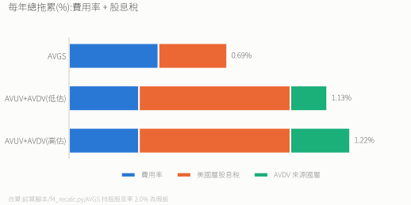
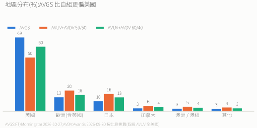

# 小型價值 ETF:AVGS vs AVUV + AVDV

> 市值型 ETF(VWRA)幾乎不含小型價值股,這一檔用來補規模與價值兩個因子。
>
> **結論:長期持有選 AVGS。** 稅務每年淨贏約 0.4–0.5%,免美國遺產稅,單檔不用再平衡。AVUV + AVDV 只在「想自訂美國 / 國際比例」或「在意 Firstrade 零手續費」時才值得。

---

## 基本資料

| | AVGS | AVUV + AVDV |
|---|---|---|
| 檔數 | 1 | 2 |
| 註冊 | 愛爾蘭 UCITS | 美國 |
| 管道 | 富邦複委託(買賣各 0.15%) | Firstrade(0 手續費) |
| 成立 | 2024-09-25 | 2019 |
| 規模 | 約 17 億美元(換算) | 約 325 億 + 200 億美元 |
| 費用率 | 0.39% | 0.25% / 0.36%(平均約 0.305%) |
| 配息 | 不配息 | 都是季配 |
| 範圍 | 全球小型價值 | 美國(AVUV)+ 已開發國際(AVDV) |
| 美國遺產稅 | 不課 | 超過 6 萬美元課 18–40% |

---

## 稅務:決勝點

**不配息不等於沒有股息稅。** 稅是在基金持股那一層扣的:

- **AVGS**:持有的美股股息在基金內被扣 15%(美愛協定),扣完滾入淨值。
- **AVUV / AVDV**:配息給台灣人時,美國扣 30%。AVDV 是「美國 ETF 包國際股」,國際股先被來源國扣一次,到美國層再扣 30%,**雙重拖累**。

**淨差約 0.44–0.53%/年,AVGS 勝**:
- 費用:AVGS 貴 0.085%。
- 美國層股息稅:AVGS 省約 0.36%(0.66 − 0.30)。
- AVDV 來源國層:再省 0.16–0.26%。
- AVGS 買進 0.15% 手續費,約 3–4 個月就賺回。

> AVGS 不配息,上圖的「股息稅」是基金持股本身的股息(假設股息率 2.0%;Avantis 官網、fact sheet、justETF、FT 都不揭露持股股息率。用 AVUV 1.38% / AVDV 2.35% 按 AVGS 約七成美國的權重推估約 1.7%(推論),2.0% 略高估 AVGS 的拖累,方向不變)在基金內被扣的稅,投資人不會收到這筆錢。AVUV / AVDV 用舊版殖利率 1.52% / 2.90%;改用 2026-10 的 SEC 殖利率(AVUV 1.38%、AVDV 2.35%,Morningstar)並把 AVGS 等比例下修(推測),淨差約 0.35–0.43%,方向不變。
>
> 舊版寫「AVGS 股息稅 0%、年省 0.66%」是錯的:AVGS 內部照扣 15%,實際優勢約一半。

---

## 地區分布

> AVGS:FT / Morningstar(2026-10-27)。AVUV + AVDV:AVDV 發行商國家權重(2026-09-30:日本 33.08%、英國 11.64%、加拿大 10.94%、澳洲 9.17%、歐洲 39%)按比例換算,並假設 AVUV 全是美國股(推論)。AVDV 的歐洲 39% 應已含英國(發行商頁未明說)。「其他」含亞洲其他地區、中東、紐西蘭。

AVGS 約七成是美國,比 AVUV + AVDV 50/50 或 60/40 更偏美國。想要**更少美國、更多國際**,才需要自己組 AVUV + AVDV,但要付上面的稅。

---

## 操作與風險

| | AVGS | AVUV + AVDV |
|---|---|---|
| 每次投入 | 買 1 檔 | 買 2 檔 |
| 每年配息處理 | 無 | 約 8 次 |
| 再平衡 | 基金內部處理 | 自己做,可能觸發稅 |
| 紀錄長度 | 約 2 年 | 6 年以上 |
| 稅法變更風險 | 低(UCITS) | 中(美國稅法) |

AVGS 規模已遠超常見的 1 億美元經驗門檻(業界說法,沒有正式出處),Avantis 整體管理資產超過 1,500 億美元(2026-06),清算風險低。

---

## 10 年試算

初始 10 萬美元,年化 8%(費用與稅前):
- AVGS:淨 7.31%,10 年後約 **20.25 萬**
- AVUV + AVDV:淨 6.78–6.87%,約 **19.26–19.44 萬**
- AVGS 多約 **8,100–9,900 美元(4.2–5.1%)**;不計 AVDV 來源國那層,多約 5,200(2.6%)。

---

## 我的選擇

**AVGS(富邦複委託)**:被動長抱、單檔、稅務淨贏、免遺產稅,與 VWRA 同為愛爾蘭 UCITS。若日後想降低美國比重,才考慮自組 AVUV + AVDV。

---

*資料 2026-10;股息稅機制與 [檔 3](./3.%20VT%20vs%20IMID%20vs%20VWRA%20vs%20VALU%20完整比較.md) 同源;出處見 [`資料來源紀錄.md`](./資料來源紀錄.md)。*
