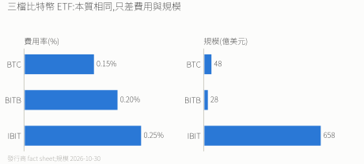
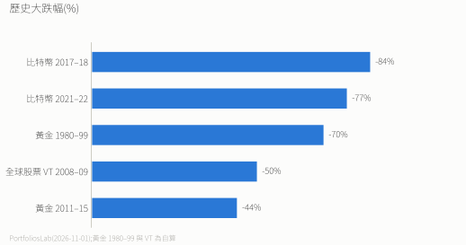

# 比特幣 ETF 投資指南

> 2026-11 更新。適合想放一小部分另類資產的長期投資者。

## 結論

- 三檔主流現貨 ETF(BTC / BITB / IBIT)**本質相同,只差費用與規模**。走 Firstrade 0 手續費都能買。
- 都不配息,沒有股息預扣稅問題。
- 都是**美國資產**:美國資產合計超過 6 萬美元時,超出部分課 18–40% 美國遺產稅。
- 建議配置 3–5%,上限 10%,當作可能歸零的錢。

---

## 三檔比較

| | BTC | BITB | IBIT |
|---|---|---|---|
| 發行商 | Grayscale(Mini Trust) | Bitwise | BlackRock |
| 掛牌 | NYSE Arca | NYSE Arca | Nasdaq |
| 定價基準 | CoinDesk Bitcoin Benchmark Rate | CME CF BRR (NY) | CME CF BRR (NY) |
| 買賣價差 | 佳 | 佳 | 最緊 |

- BTC 最便宜(比 IBIT 少 0.10%),IBIT 規模約大 14 倍。
- 0.05–0.10% 的費差,很可能被小檔較大的價差吃掉。
- **已持有 IBIT 不必換**:換倉要付價差,賣出還會實現海外所得。全新資金又很在意費用,才直接選 BTC。

---

## 風險

| | 比特幣 | 全球股票 VT | 黃金 |
|---|---|---|---|
| 年化波動 | 長期 60–80%;近 1 年約 37–44% | 2008–2026 全期 20.6%;近 5 年 16.2%;近 1 年 13.6% | 近 1 年約 29% |
| 與美股相關性(近 1 年) | 約 0.45 | 約 0.95(2008–2026 日報酬) | 約 0.34–0.42(長期約 0.07) |

- 比特幣史上最深跌過 93%(2011)。
- 跟股票的相關性在系統性風險時會升高,別當避險資產。

> 來源:PortfoliosLab(2026-11-01)、CoinGecko 日價自算、本 repo `vt.csv` 自算。近 1 年數字會變動。

---

## 配置與再平衡

| 風險承受度 | 建議 | 上限 |
|---|---|---|
| 保守 | 0–3% | 3% |
| 穩健 | 3–5% | 5% |
| 積極 | 5–7% | 10% |

- 分 3–5 批建倉。
- 每季看一次,超過 7% 減碼、低於 3% 加碼,調回 5%。

---

## IBIT 換 BTC 值不值得?

費差 0.10%/年。假設比特幣年化 30%(非常樂觀)、持有 10 年,換到 BTC 多出的資產:

- 全部是既有部位:0.77%
- 既有與新投入各半:約 0.71%
- 全部是之後的定期定額:0.54%

這是比例,跟金額無關。

- **支持換**:Firstrade 換倉零手續費;10 年多約 0.5–0.8%。
- **不支持換**:賣 IBIT 若有獲利,可能觸發海外所得(全年達 100 萬計入;扣除額 750 萬);IBIT 成交量約 BTC 的 30 倍,常調倉的人價差會吃掉優勢;不到 1% 的優勢,比特幣一天就能波動掉。

**沒有標準答案**:長期不動、沒有獲利要實現 → 可以換;偶爾調倉或帳面獲利大 → 留在 IBIT。

---

## 常見問題

**選哪一檔?** 要最便宜選 BTC,要最大規模、最緊價差選 IBIT。

**ETF 還是自己持有比特幣?** ETF 安全方便、報稅簡單,但有管理費,而且是美國資產,要算進美國遺產稅;自己持有不是美國註冊的證券,但台灣遺產稅照樣要課,還要自己保管、讓家人拿得到私鑰。多數人用 ETF 比較實際。

*比特幣是高風險資產,只能小比例配置,不能當主力。非投資建議。*
