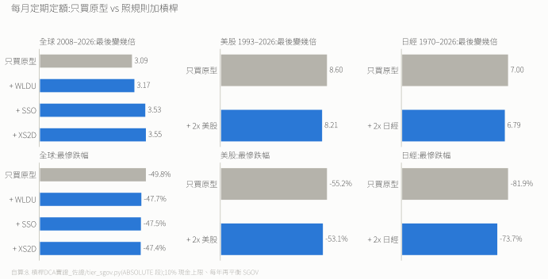
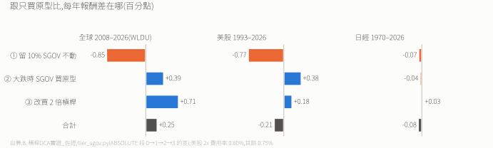

# 槓桿 DCA 實證

> [`0. 投資心法總綱.md`](./0.%20投資心法總綱.md) 第 4 點「大跌後 DCA 槓桿 ETF」的回測。
> 這是白話精簡版;完整表格與技術細節見 [`完整技術版`](./8.%20槓桿DCA實證_佐證/完整技術版.md)。

---

## 一句話結論

**照規則在大跌時分批買一點 2 倍槓桿,跟「每月全部買原型」比,每年差 −0.2 到 +1.3 個百分點:全球小贏、美股小輸、日本打平。** 差距這麼小,主要是因為規則要一直留 10% SGOV,這筆現金每年拖累約 0.8 個百分點;大跌時動用 SGOV + 槓桿,在全球賺回來還多一點,在美股賺不回全部。可有可無,要不要玩自己決定。

---

## 規則

1. **平常**:每月的錢 90% 買原型(全球股票 ETF),10% 存 SGOV(短期美債,當現金用)。
2. **大跌時動用 SGOV**:VWRA(美元收盤價)從最高點跌 20%、30%、50% 時,各拿一批 SGOV 買 **2 倍**槓桿 ETF(1/3 → 剩下的 1/2 → 全部)。創新高後,三批才重新準備。
3. **跌超過 30% 時**:每月原本買原型的那 **90%** 改買 2 倍槓桿,存 SGOV 的 10% 照存;漲回前高的 80% 就改回買原型。之後如果又跌破 −30%,再切過去。
4. **上限**:累積丟進槓桿的錢 ≤ 總投入的 10%。滿了之後,沒用到的 SGOV 留著,新錢回去買原型。
5. **什麼都不賣**:不賣原型換槓桿,也不賣槓桿換原型。
6. **每年再平衡**:槓桿部位**不參與、不算進任何比例**。SGOV 調回「原型 + SGOV」的 10%,但**只在三批都還沒用掉、而且新錢沒有切到槓桿時才做**;用掉之後只靠每月新錢的 10% 慢慢補,不在低點賣股票補現金。
7. **只用 2 倍**,不用 3 倍。標的若被清算,拿回的錢買原型,不追買別的槓桿 ETF。

---

## 要不要冒險:跟「只買原型」比

同樣每月投入,一組全部買原型(不留現金),另一組照上面的規則。「最後變幾倍」= 期末市值 ÷ 總投入;「最慘跌幅」已扣除新投入的影響。

| 每年報酬 | 只買原型 | 留 10% SGOV、永遠不用 | 照規則加槓桿 |
|---|---|---|---|
| 全球 2008–2026 | 11.41% | 10.56% | 11.66%(WLDU)/ 12.67%(SSO)/ 12.73%(XS2D) |
| 美股 1993–2026 | 10.75% | 9.98% | 10.54% |
| 日經 1970–2026 | 5.71% | 5.64% | 5.63% |

- **留 10% 現金是最大的成本**:全球和美股每年少約 0.8 個百分點。照規則動用 SGOV + 槓桿,全球(WLDU)賺回 1.1,比拖累多一點;美股賺回 0.6,不到拖累;日本幾乎沒賺回。
- **跟只買原型比,多賺的很少甚至是負的**:全球 WLDU 每年 +0.25;美股 −0.2;日本 −0.1。
- **XS2D / SSO 在全球那組贏比較多,是因為 2008 年後美股跑贏全球**,等於額外押了美國。
- **跌幅比只買原型小一點,是 SGOV 墊的,不是槓桿**:全球 −47.7% 對 −49.8%、美股 −53.1% 對 −55.2%、日本 −73.7% 對 −81.9%。那 10% 現金不會跌,槓桿又是跌到一半才開始買、最多只佔組合 17–26%,所以抵掉後還略小。真的全押 2 倍,2008 年 SSO 跌了 84.7%。

> 回測只包含「原型 + SGOV + 槓桿」三塊,沒有 AVGS、IBIT、0050。2026-11-01 起加入第 6 條的再平衡;沒有再平衡的舊結果見 [完整技術版](./8.%20槓桿DCA實證_佐證/完整技術版.md)。

### 虧在哪:一步一步拆開

把「只買原型 → 照規則加槓桿」拆成三步,一步一步加上去,看每一步讓每年報酬變多少:

| 每年報酬變化(百分點) | 全球(WLDU) | 美股 | 日經 |
|---|---|---|---|
| ① 每月 10% 存 SGOV、永遠不用 | −0.85 | −0.77 | −0.07 |
| ② 大跌三段把 SGOV 拿去買**原型**(還沒用槓桿) | +0.39 | +0.38 | −0.04 |
| ③ 同樣的時機改買 **2 倍槓桿**,加上新錢切換(實際規則) | +0.71 | +0.18 | +0.03 |
| 合計:照規則 vs 只買原型 | +0.25 | −0.21 | −0.08 |

- **虧在一直留 10% 現金,不是槓桿**:三個市場裡,第 ③ 步(槓桿本身)都是正的;拖累幾乎全部來自第 ① 步。
- 所以「要不要槓桿」和「要不要留 10% SGOV」是兩個問題。如果 SGOV 只是為了大跌時有子彈,這筆現金在美股、全球都賠多賺少;留它的理由要另外找(例如睡得著、提領期的緩衝),不能靠槓桿撐。
- 日經的 ① 很小,是因為這段期間日經(不含股息)每年只漲約 5.7%,跟 SGOV 的利息(回測用美國國庫券利率)差不多,留現金幾乎不吃虧。
- 數字來自 `tier_sgov.py` 的 ABSOLUTE 段:0 只買原型 → 1 留 SGOV 不動 → 2 SGOV 改買原型 → 3 實際規則,相鄰兩列的差。

---

## 為什麼要這幾條鐵則

**① 只能分批買,絕不一次梭哈。**
日經在 1992 年跌掉一半時一次全買 2 倍槓桿,抱到 2026 年只剩 **1.04 倍**(買原型是 3.58 倍),中途最慘跌掉 96.8%;3 倍槓桿只剩 0.07 倍,幾乎歸零。照規則分批買的話,日本最後是 6.79 倍對 7.00 倍,只小輸一點。**害死人的不是槓桿,是一次梭哈。**

**② 不賣原型換槓桿,也不賣槓桿換原型。**
原型是保命的核心,不拿去換高風險的東西;已經買的槓桿也不必在反彈時賣掉換回來,只要改新錢的去向就好。

**③ 上限要用「丟進去的錢」算,不能用「現在值多少」算。**
在日本的長期熊市裡測過:如果規定「槓桿市值不超過總資產 10%」,槓桿一直跌、市值看起來很小,規則永遠不會喊停,結果丟進去的錢累積到 **23.8%**;改成「累積丟進去的錢不超過總投入 10%」,才鎖在 **9.5%**。

**④ 漲回前高 80% 就把新錢改回原型。**
等漲回 100% 再改回會多賺一些(美股不設上限時 +51% 對 +34%),但平時槓桿佔比會多一倍。在日本兩種都擋不住(槓桿佔比 59–65%),因為日經幾十年都沒漲回去。所以這條只是在「多賺」和「睡得著」之間選後者,**真正保命的是第 ③ 條的上限**。

> 不設上限的話,回測好處大很多(例如美股 2x +34%),但那是讓槓桿佔到總資產 15–65% 換來的。加上 10% 上限後縮水成上面那張表的樣子。3 倍槓桿的報酬和耗損都更大,本專案只用 2 倍。

---

## 為什麼槓桿只能當配角

- **小比例時,大跌多痛一點點而已**:2007–2009 金融海嘯,美股(SPY)跌 55.2%、2 倍槓桿(SSO)跌 84.7%。整體資產放 10% 在 SSO,總共跌 58.1%,只比全部原型多跌約 3 個百分點(放 15% 多 4.4)。忍得住。
- **放越多,多賺的越少**:不設上限時,全球槓桿佔 5% 多賺 15%,佔到 30% 也只多賺 41%。風險放大 6 倍,報酬只多 2.7 倍。
- **當主力會出事**:大部分資產都在槓桿裡時,大跌會讓總資產腰斬不止,很可能在最低點砍掉,帳面虧損變成真的虧損。原型跌深了通常會漲回來,只是可能很久(日經 1989 年的高點花了 34 年);槓桿跌深了,就算指數回到原點,槓桿通常還在虧。

核心已經是原型(VWRA / VALU + AVGS + 比特幣);槓桿只是賭贏加一點、賭輸不傷核心的小配角。

---

## 用哪一檔

只考慮倫敦(LSE)和美股掛牌。查證範圍內,**倫敦沒有「全球 2 倍」的 UCITS 基金**;德國掛牌的全球 2 倍(LVWC、SC2X)不考慮。剩下三檔:

| 標的 | 追蹤 | 註冊地 | 費用率 | 規模 | 優點 | 缺點 |
|---|---|---|---|---|---|---|
| **XS2D**(LSE,美元) | S&P 500 2 倍 | 盧森堡 UCITS | 0.60% | 約 €5.6 億,2010 年成立 | 不是美國註冊,應該不算美國遺產稅的課稅資產(推論,未查稅法原文) | 只押美國 |
| **SSO**(美股) | S&P 500 2 倍 | 美國 | 淨 0.84% | 約 $84.5 億,2006 年成立 | 規模大、好買賣 | 只押美國;美國註冊要計入遺產稅規則 |
| **WLDU**(美股) | VT 2 倍(全球) | 美國 | 0.75% + swap 成本(未揭露) | 約 282 萬美元,2026 年成立 | 唯一真正全球的 | 太小、可能被清算;美國註冊;買賣價差約 0.30% |

- 要全球只能選 WLDU,要避開美國註冊只能選 XS2D,兩者沒辦法兼得。
- 倫敦同代號的「WLDU」是 Amundi 的 1 倍全球基金,不是槓桿,別買錯。
- 下單前要確認:富邦複委託清單裡有沒有這檔、「正二反一槓桿」交易資格是否開通(都未查證)。
- 規格出處見 [`資料來源紀錄.md`](./資料來源紀錄.md)。

---

## 那借錢(信貸)來加槓桿呢?

論文《Beyond the Status Quo》算過這件事(Table VII Panel M)。關鍵是**借貸利差** = 借款利率減掉國庫券利率:

| 借貸利差 | 代表誰 | 論文算出的最佳借款比例 |
|---|---|---|
| 6.50% | 一般人的借貸成本(約等於券商融資利率中位數) | **0%,不要借** |
| 1.40% | 最便宜的券商融資 | 55% |
| 0.37% | 用衍生品借錢的隱含成本(接近無風險利率) | 100%(模型上限) |

借到 3% 的信貸,看起來接近 1.4% 那列,但實際更差:

- **信貸要按月還本**:股災時可能得賣股票來付月付。論文假設借款不用還本、沒有追繳、沒有交易成本。
- **3% 常常只是前幾期優惠**,之後跳到 5–7%,就回到「不要借」那一側。
- **台灣信貸利息不能抵稅**。
- 借台幣投資美元資產看起來利差是負的,但那是在承擔匯率風險,不是免費。

**結論:別借錢加槓桿。** 想要槓桿就用上面的小額、分批、有上限的做法;把月付的錢拿去正常定期定額更好。

---

## 數字可不可信、還不知道什麼

**可信的部分**
- 模擬的槓桿 ETF 跟真實 ETF 逐日比對過:2 倍對 SSO 的每日報酬相關係數 0.9956,3 倍對 UPRO 0.9983。
- 同一套規則用模型跑是 +22.1%,換成真實 SSO 價格是 +22.4%,只差 0.3 個百分點。

**還不知道的部分**
- **歷史只有一條路**:全球資料只有 18 年(2008 起),美股日資料 33 年,日經 56 年。從來沒有「全世界一起爛十年」的資料。
- 日經用的是不含股息的價格指數,融資成本用 0.5%,低估了 1970–1995 年的利率,結果對槓桿偏有利。
- XS2D 和 WLDU 的結果是模型推估,不是真實價格。

---

> **完整佐證**:[`8. 槓桿DCA實證_佐證/`](./8.%20槓桿DCA實證_佐證/)(腳本、原始資料、重跑方法見其中的 `README.md`;本頁數字主要來自 `tier_sgov.py` 的 `ABSOLUTE` 段)。
> 改寫前的完整技術版(兩個旋鈕的測試、1929 情境、世代穩健性、候選標的完整比較):[`完整技術版.md`](./8.%20槓桿DCA實證_佐證/完整技術版.md)。
