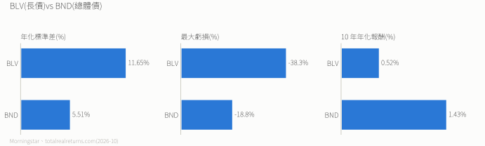

# 沉沒成本案例:BLV vs BND

> **情境**:長期指數投資者,BLV(長期債)佔 10%,目前虧 10%。要等回本再換成 BND(總體債)嗎?
>
> **答案**:不用等。過去的虧損不該影響現在的決定,只比「從今天起哪個比較好」。

---

## 數據比較

| | BLV | BND |
|---|---|---|
| 存續期間 | 12.4 年 | 5.7 年 |
| 費用率 | 0.03% | 0.03% |
| 退稅率* | 100%(作者實測,富邦與 Firstrade 皆同) | 約 90–93%(部落格實測) |

- BND 年化報酬多 0.91 個百分點、最大虧損少一半、波動減半。
- 100 萬持有 5 年,用過去 10 年報酬外推,BND 約多 4.6 萬(僅示意)。
- 最大虧損都發生在 2020-08 起的升息債災,BLV 至今沒回到前高。

> 資料 2026-10:存續期間、標準差來自 Morningstar;最大虧損與 10 年報酬(含息,至 2026-10-30)來自 totalrealreturns.com。
> *退稅率是台灣投資人的說法:美國債券 ETF 配息先被扣 30%,隔年經券商退回的比例,每年依基金申報而不同,不是官方數據。

**照本專案自己的原則**([檔 0](./0.%20投資心法總綱.md):核心 0 債券),真正的答案是**賣掉 BLV、不再買債券**,錢回到股票組合。這裡比 BND 只是為了示範沉沒成本。

---

## 沉沒成本的四種說法

| 心理 | 你會聽到自己說 |
|---|---|
| 損失厭惡 | 「都虧了,不能現在賣」 |
| 認知失調 | 「賣掉就代表我判斷錯」 |
| 承諾升級 | 「再給它點時間」 |
| 心理帳戶 | 「這是 BLV 那一桶,先不管」 |

**決策四步**:把問題改成「現在哪個比較好」→ 忽略已經虧的 → 只看未來的報酬與風險 → 數據支持就執行。

技巧:想像今天剛拿到這筆現金,你會買哪一個?

---

## 練習

1. 科技 ETF 虧 25%,另一檔表現更好。→ **立即換或分批換**;等回本是沉沒成本。
2. 主動基金績效差、費用高。→ **馬上轉指數基金**;再給一年、等超越、加碼都是陷阱。
3. 航空股虧 40%,現在更想買別的。→ **重新比較兩者的未來**;等漲回來是情緒決策。

---

## 延伸閱讀

《快思慢想》Kahneman、《投資最重要的事》Howard Marks、《行為投資學》Montier、《漫步華爾街》Malkiel。

> **好的投資不是避免虧損,是做出最合理的選擇。**
