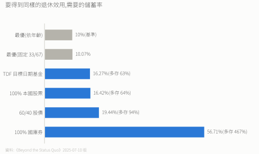

# 📈 長期指數化投資研究

> 以學術研究為基礎的被動投資策略與執行紀錄。

**線上閱讀**:[jayhsuegg.github.io/FinancialAnalysis](https://jayhsuegg.github.io/FinancialAnalysis/)

## 核心依據

論文 *Beyond the Status Quo: A Critical Assessment of Lifecycle Investment Advice*(Anarkulova、Cederburg、O'Doherty;本專案以 `paper/` 內附的 2025-07-10 版核校,SSRN 4590406)。

| 傳統建議 | 論文結論 |
|---|---|
| 60/40 股債 | 次優 |
| 隨年齡降股票 | 降低終身財富 |
| 偏重本國 | 犧牲分散 |
| **最佳** | **100% 股票(1/3 本國 + 2/3 國際)** |

- 資料:39 個已開發國家(不含台灣)、1890–2023。
- 退休後錢花光的機率:最優 6.7%,TDF 19.7%,60/40 16.9%。
- 用一般融資利率借錢,最佳槓桿是 0%。
- 越相信美國會一直贏,最優美股比重越高(0% 信念 → 33%,50% → 60%)。

細節見 [論文筆記](10.%20論文筆記：Beyond%20the%20Status%20Quo.md)。

## 券商與稅務(台灣投資者)

| 平台 | 買什麼 | 手續費 |
|---|---|---|
| Firstrade | 美國註冊標的(SGOV、IBIT 等) | 0 |
| 富邦複委託 | 倫敦掛牌的愛爾蘭 UCITS(VWRA、VALU〔富邦代號 VAVALU〕、AVGS、IB01) | 買賣各 0.15% |

- 富邦英股網路單**牌告 0.6%**(2026-11 官網);本專案試算用的 0.15% 是作者實際取得的優惠費率(個人實測),各人能拿到的優惠不同,試算前請換成自己的費率。
- 美股股息對台灣人預扣 30%(台美租稅法案截至 2026-10 未生效);愛爾蘭 UCITS 在基金層只扣 15%。
- 美國資產超過 6 萬美元的部分課 18–40% 美國遺產稅;愛爾蘭 UCITS 不課。
- SGOV 配出的美國公債利息依 IRC 871(k)(1) 免預扣(作者在兩家券商實測最終稅負 0%)。

## 文件

| # | 文件 | 內容 |
|---|---|---|
| 0 | [投資心法總綱](0.%20投資心法總綱.md) | 原則,最先讀 |
| 1 | [2026 投資執行紀錄](1.%202026投資執行紀錄.md) | 個人配置、父母組合、遺產稅 |
| 2 | [0050 vs 連結基金](2.%200050%20ETF%20vs%20元大台灣卓越50連結基金A類完整比較分析.md) | 費用與稅 |
| 3 | [VT vs IMID vs VWRA vs VALU](3.%20VT%20vs%20IMID%20vs%20VWRA%20vs%20VALU%20完整比較.md) | 全球股票 ETF 比較,附換股試算 |
| 4 | [AVGS vs AVUV+AVDV](4.%20小型價值因子ETF完整比較：AVGS%20vs%20AVUV+AVDV.md) | 小型價值因子 |
| 5 | [SGOV vs IB01 vs BOXX](5.%20短期美債ETF%20SGOV%20vs%20IB01%20完整分析.md) | 短債:預扣稅與遺產稅 |
| 6 | [比特幣 ETF](6.%20比特幣ETF投資指南.md) | BTC / BITB / IBIT |
| 7 | [全球分散 vs 集中](7.%20VT全球分散投資%20vs%20地區產業集中投資學術分析報告.md) | VT vs VOO vs SMH |
| 8 | [槓桿 DCA 實證](8.%20槓桿DCA實證.md) | 大跌時分批買槓桿的回測 |
| 9 | [沉沒成本案例](9.%20沉沒成本效應案例學習.md) | BLV vs BND |
| 10 | [論文筆記](10.%20論文筆記：Beyond%20the%20Status%20Quo.md) | 論文重點 |
| 11 | [提領規則](11.%20提領規則.md) | 退休後怎麼領:方式、提領率、順序、緩衝、長壽風險 |
| S | [Sin A Little 投機部位](Sin%20A%20Little%20投機部位討論紀錄%202026-08-24.md) | 主題 ETF 剔除紀錄與定案 |

**資料來源與佐證**

| 文件 | 內容 |
|---|---|
| [資料來源紀錄](資料來源紀錄.md) | 每個數字的出處、資料日期、查證日期 |
| [勘誤紀錄 2026-11-01](勘誤紀錄%202026-11-01.md) | 全面查核的錯誤、修正與翻轉的結論 |
| [試算腳本](試算腳本/) | 自算數字的腳本 |
| [槓桿回測佐證](8.%20槓桿DCA實證_佐證/) | 檔 8 的腳本與原始資料 |
| [圖表](圖表/) | 所有圖表與產生腳本 |

## 🚧 TODO

- [x] **提領規則專篇**:已完成,見 [檔 11](11.%20提領規則.md)(2026-11-07)。

## ⚠️ 免責聲明

僅供學術研究與個人學習,不構成投資建議。投資有風險,數據可能有誤,請以官方來源為準;過去績效不代表未來。

## 📖 參考資料

- Anarkulova, A., Cederburg, S., & O'Doherty, M. S. (rev. 2025-07-10). *Beyond the Status Quo: A Critical Assessment of Lifecycle Investment Advice*. SSRN 4590406.(全文見 [`paper/`](./paper/))
- Bogle, J. C. (2007). *The Little Book of Common Sense Investing*.
- Malkiel, B. G. (2019). *A Random Walk Down Wall Street*.

## 📝 授權

[CC BY-NC-SA 4.0](https://creativecommons.org/licenses/by-nc-sa/4.0/):可分享與改作、需標註出處、不可商用、改作需以相同授權釋出。

---

*最後更新:2026 年 11 月*
